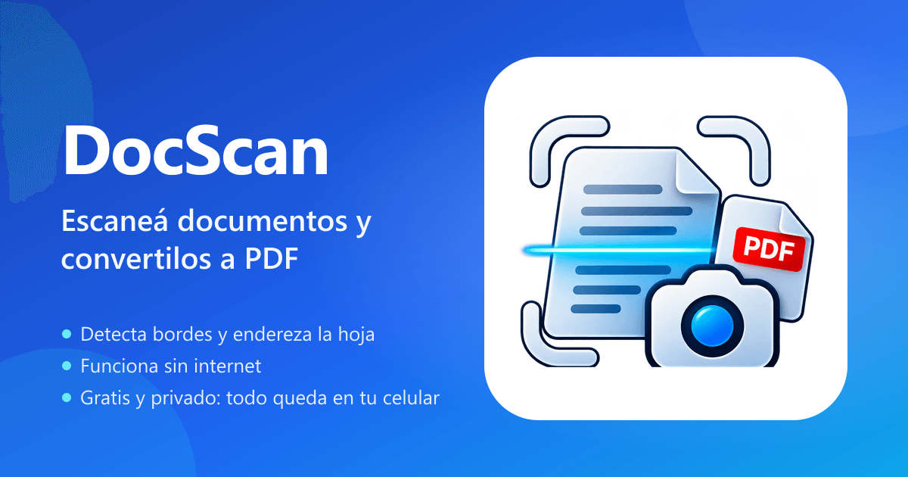

<div align="center">


# DocScan

**Escaneá documentos con la cámara del celular y convertilos a PDF.**
Detecta los bordes, endereza la hoja, aplica filtros y funciona sin internet. Todo se procesa en tu dispositivo.

**[docscan.imperial-net.com](https://docscan.imperial-net.com)**

[](LICENSE)




</div>

---

## Características

- **Captura** con la cámara trasera (con flash y modo ráfaga) o importando fotos de la galería.
- **Detección automática de bordes** y **corrección de perspectiva** con OpenCV, en un Web Worker.
- **Editor de esquinas** con lupa para ajustar el recorte a mano.
- **Filtros**: original, mejorado, escala de grises y blanco y negro (umbral adaptativo), más brillo, contraste y rotación.
- **Gestión de páginas**: reordenar arrastrando, duplicar, eliminar y agregar más.
- **Exportar a PDF** en tamaño Ajustado, A4 o Carta, con tres niveles de calidad y el peso visible antes de exportar.
- **Compartir** por WhatsApp, mail, Drive y demás (Web Share API), o descargar. También como JPG.
- **Biblioteca** con búsqueda, orden, carga progresiva y acciones rápidas.
- **PWA instalable** que funciona 100 % offline.
- **Privada**: no hay servidor ni cuentas. Los documentos se guardan en IndexedDB, en el propio dispositivo.

## Cómo se usa

1. Abrí la app y tocá **Escanear**.
2. Sacá una o varias fotos (o elegilas de la galería) y tocá el botón de confirmar.
3. DocScan detecta cada hoja y la endereza. Tocá una página para cambiarle el filtro, rotarla o recortarla.
4. Tocá **Exportar PDF** y compartilo o descargalo.

**Para instalarla:**

- **Android (Chrome):** tocá **Instalar app** en el aviso de la app, o **⋮ → Instalar app**.
- **iPhone (Safari):** tocá **Compartir → Agregar a inicio**.

## Stack

| Área | Tecnología |
|---|---|
| UI | React 19, TypeScript, Tailwind CSS v4, lucide-react |
| Build y PWA | Vite 6, vite-plugin-pwa (Workbox) |
| Visión | OpenCV.js (WASM) en Web Worker |
| PDF | pdf-lib |
| Persistencia | IndexedDB con Dexie |
| Drag & drop | dnd-kit |
| Tests | Vitest y Testing Library |

## Desarrollo

Requiere Node.js 20 o superior.

```bash
git clone https://github.com/MichaelIllescas/docscan.git
cd docscan
npm install        # también copia OpenCV a public/vendor (postinstall)
npm run dev
```

| Script | Qué hace |
|---|---|
| `npm run dev` | Servidor de desarrollo |
| `npm run build` | Build de producción + service worker |
| `npm run preview` | Sirve el build (para probar la PWA y el modo offline) |
| `npm test` | Tests unitarios |
| `npm run lint` | ESLint |
| `npm run generate-pwa-assets` | Regenera los íconos desde `design/logo-icon.png` |
| `npm run generate-og-image` | Regenera la imagen para redes (`public/og-image.png`) |

> La cámara y el service worker necesitan **HTTPS**. En la PC, `localhost` alcanza. Para probar en el celular usá el deploy (o un túnel HTTPS).

## Estructura

```
src/
  app/              # avisos de actualización e instalación
  domain/           # reglas puras y testeadas: documentos, páginas, geometría, filtros, exportación
  infrastructure/
    db/             # IndexedDB (Dexie) y repositorio
    vision/         # worker de OpenCV: detección de bordes y perspectiva
    pdf/            # armado del PDF con pdf-lib
  features/         # pantallas: biblioteca, captura, recorte, editor, documento, exportar
  shared/           # componentes de UI, hooks y utilidades
```

Más detalle en [docs/01-requisitos.md](docs/01-requisitos.md) y [docs/02-arquitectura.md](docs/02-arquitectura.md).

## Deploy

La app es estática: todo corre en el navegador.

- **Vercel** (recomendado): importá el repo en [vercel.com](https://vercel.com) y desplegá. La configuración está en `vercel.json`.
- **Netlify**: "Import from Git". Usa `netlify.toml`.
- **Hosting Apache (Hostinger, cPanel)**: corré `npm run build`, subí la carpeta `dist/` a `public_html` y copiá [`deploy/hostinger.htaccess`](deploy/hostinger.htaccess) como `public_html/.htaccess`. Sirve `dist/` desde la raíz, fuerza HTTPS, comprime y resuelve las rutas de la app.
- **URL pública**: las tarjetas de WhatsApp y redes, el canonical y el sitemap usan `https://docscan.imperial-net.com`. Para otro dominio, definí la variable de entorno `SITE_URL`.

## Privacidad

Las fotos y los PDF nunca salen del dispositivo: no hay backend, analítica ni cuentas. Si borrás los datos del navegador o desinstalás la app, los documentos se eliminan, así que exportá los importantes.

## Licencia

[MIT](LICENSE) © 2026 MichaelIllescas
